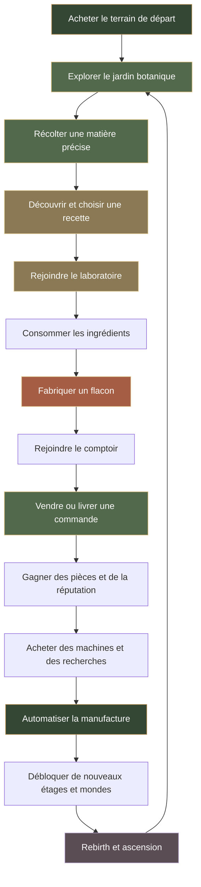
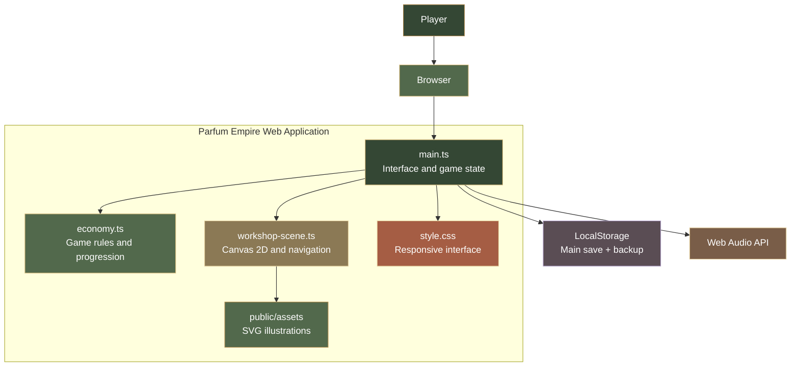

 <div align="center">

<a id="top"></a>


<br>


<br>

**Cultive ton jardin. Compose tes fragrances. Développe ta maison de parfumerie.**

A 2D browser-based perfume tycoon with exploration, deterministic gathering, handcrafted recipes, automated production and prestige progression.

<br>

[](https://github.com/RufusTheDwarf/parfum-empire)
[](https://www.typescriptlang.org/)
[](https://vite.dev/)
[](https://vitest.dev/)
[](https://nodejs.org/)
[](https://developer.mozilla.org/en-US/docs/Web/API/Canvas_API)
[](https://developer.mozilla.org/en-US/docs/Web/SVG)
[](https://developer.mozilla.org/en-US/docs/Web/API/Window/localStorage)
[](https://developer.mozilla.org/en-US/docs/Web/API/Web_Audio_API)
[](LICENSE)

[](package.json)
[](https://github.com/RufusTheDwarf/parfum-empire/actions/workflows/ci.yml)
[](.devcontainer/devcontainer.json)
[](package.json)
[](apps/web/src/workshop-scene.ts)
[](docs/ARCHITECTURE.md)

<br>

[](https://github.com/RufusTheDwarf/parfum-empire/stargazers)
[](https://github.com/RufusTheDwarf/parfum-empire/forks)
[](https://github.com/RufusTheDwarf/parfum-empire/issues)
[](https://github.com/RufusTheDwarf/parfum-empire/commits/main)
[](https://github.com/RufusTheDwarf/parfum-empire)

<br>

[**Explore the project**](https://github.com/RufusTheDwarf/parfum-empire) · [**Run the game**](#05--installation) · [**Game systems**](#03--gameplay-systems) · [**Architecture**](#07--technical-architecture)

</div>

<p align="center">

</p>

<div align="center">


<br>

<sub>ORIGINAL GAME ARTWORK // PARFUM EMPIRE</sub>

</div>

## 01 / Présentation

**Parfum Empire** est un jeu de gestion en 2D jouable dans un navigateur.

Le joueur commence avec un terrain vide et construit progressivement sa propre maison de parfumerie. Il doit récolter des matières botaniques, apprendre à composer des fragrances, fabriquer des flacons, vendre ses créations et développer une manufacture automatisée.

Le jeu combine deux dimensions :

- **L'atelier explorable :** un monde 2D dans lequel le personnage se déplace entre le jardin botanique, le laboratoire, le comptoir et les différents étages.
- **La gestion tycoon :** une économie de production, des machines, des recherches, des commandes clients, plusieurs collections et un système de prestige.

L'objectif est de passer d'un petit atelier artisanal à un empire de parfumerie capable de produire des essences rares.

### Identité visuelle

L'interface adopte une direction artistique inspirée d'une maison de parfumerie traditionnelle :

| Couleur | Utilisation |
|---|---|
| Vert mousse `#344735` | Identité principale |
| Sauge `#53694C` | Nature et botanique |
| Ivoire `#F6F0E2` | Fonds et panneaux |
| Laiton `#B28A4D` | Prestige et détails |
| Cuivre `#A55E43` | Accents et interactions |
| Encre `#292C24` | Texte et contraste |

Le monde et les illustrations utilisent cette palette, avec des variations visuelles selon la collection active.

<p align="center">

</p>

## 02 / Vue d'ensemble du jeu

<div align="center">


</div>

<grid>

</grid>

| Système | Contenu actuel |
|---|---:|
| Matières botaniques | 7 |
| Recettes de parfum | 5 |
| Équipements de production | 10 |
| Recherches améliorables | 5 |
| Collections / mondes | 3 |
| Étages accessibles | 3 |
| Parcelles botaniques bonus | 3 |
| Rangs de réputation | 10 |
| Durée maximale de production hors ligne | 8 heures |

Ces éléments sont définis dans le moteur économique TypeScript et les systèmes de progression du jeu.

## 03 / Gameplay Systems

### La boucle de jeu

Le gameplay repose sur une progression concrète. Les matières ne sont pas obtenues par des récompenses aléatoires : chaque parcelle du jardin correspond à une ressource précise.



### 1. Le terrain et le jardin botanique

Une nouvelle partie commence sur un terrain non développé.

Le joueur doit acheter le terrain de départ pour **1 000 pièces** avant de pouvoir commencer la production artisanale.

Le jardin propose sept matières :

| Matière | Rareté |
|---|---|
| Lavande | Commune |
| Menthe | Commune |
| Pétales de rose | Inhabituelle |
| Bergamote | Inhabituelle |
| Bois de santal | Rare |
| Jasmin | Rare |
| Résine ambrée | Très rare |

Chaque parcelle est associée à une matière déterminée. Le joueur choisit où se rendre et ce qu'il souhaite récolter.

Les interactions utilisent le déplacement du personnage et la proximité des postes. Tenir la touche d'interaction ne déclenche pas une récolte en boucle : l'action est déclenchée sur l'appui initial.

<div align="center">


<sub>BOTANICAL COLLECTION // SEVEN MATERIALS</sub>

</div>

### 2. Carnet de formulations

Le laboratoire permet de fabriquer cinq parfums.

Chaque recette possède une combinaison d'ingrédients et un prix de vente défini.

| Parfum | Ingrédients nécessaires | Prix de vente de base |
|---|---|---:|
| Brise verte | 1 lavande + 1 menthe | 2 |
| Rose tendre | 1 lavande + 1 rose | 3 |
| Aube citronnée | 1 bergamote + 1 menthe | 4 |
| Bouquet royal | 1 lavande + 1 rose + 1 jasmin | 6 |
| Velours ambré | 1 santal + 1 résine + 1 jasmin | 10 |

Les ingrédients nécessaires sont consommés lors de la formulation.

Le joueur doit donc organiser ses récoltes avant de pouvoir produire les parfums les plus complexes.

Les améliorations de finition peuvent ensuite augmenter la valeur de vente des flacons.

### 3. Fabrication et vente

L'atelier contient plusieurs postes physiques :

- Le jardin botanique pour la récolte.
- Le laboratoire pour composer les parfums.
- Le comptoir pour vendre les flacons.
- Les escaliers pour accéder aux étages supérieurs.

Le joueur doit rejoindre le bon poste pour effectuer l'action.

La vente génère des revenus et contribue à la progression de la maison.

### 4. Commandes clients

Des clients passent commande auprès de la parfumerie.

Le système comprend cinq modèles de commandes déterministes, avec des clients, des maisons et des parfums demandés différents.

Le joueur doit :

1. Consulter la demande active.
2. Préparer le bon parfum.
3. Fabriquer la quantité demandée.
4. Rejoindre le comptoir.
5. Livrer la commande complète.

Une livraison réussie apporte une prime supplémentaire et augmente la réputation de la maison.

La réputation comporte dix rangs, avec une prime de livraison qui progresse de 50 % jusqu'à 95 %.

La quantité demandée augmente progressivement, jusqu'à un maximum de cinq flacons.

### 5. Parcelles bonus

Trois parcelles supplémentaires peuvent être achetées :

| Parcelle | Matière | Prix |
|---|---|---:|
| Seconde parcelle | Lavande | 2 500 |
| Troisième parcelle | Menthe | 25 000 |
| Quatrième parcelle | Rose | 250 000 |

Les parcelles bonus restent invisibles et inaccessibles tant qu'elles n'ont pas été achetées.

Elles permettent d'augmenter progressivement la capacité de récolte du jardin.

<p align="center">

</p>

## 04 / The Manufacture

La manufacture constitue le cœur de la progression automatisée.

Les équipements permettent de générer une production passive sans devoir effectuer chaque action manuellement.

Il existe dix machines réparties entre les différents étages.

### Catalogue des machines

| Équipement | Étage | Fonction |
|---|---:|---|
| Table de formulation | 0 | Mélange les premières notes parfumées |
| Alambic de cuivre | 0 | Distille des extraits |
| Ligne d'embouteillage | 1 | Remplit et ferme les flacons |
| Atelier de parfumeur | 1 | Produit des compositions premium |
| Extracteur astral | 2 | Synthétise des essences rares |
| Serre botanique | 1 | Cultive des matières premières |
| Presse à enfleurage | 1 | Capture les notes florales |
| Atelier de luxe | 2 | Produit des parfums haut de gamme |
| Distillateur de cristal | 2 | Traite les essences spécialisées |
| Manufacture orbitale | 2 | Équipement industriel avancé |

<div align="center">

<table>
<tr>
<td align="center" width="33%">

<br><sub>FORMULATION</sub>
</td>
<td align="center" width="33%">

<br><sub>DISTILLATION</sub>
</td>
<td align="center" width="33%">

<br><sub>EMBOUTEILLAGE</sub>
</td>
</tr>
<tr>
<td align="center" width="33%">

<br><sub>ENFLEURAGE</sub>
</td>
<td align="center" width="33%">

<br><sub>CRISTAL</sub>
</td>
<td align="center" width="33%">

<br><sub>MANUFACTURE</sub>
</td>
</tr>
</table>

<sub>ORIGINAL PRODUCTION MACHINE ASSETS // PUBLIC/ASSETS</sub>

</div>

### Production economics

Chaque équipement possède :

- Un coût d'achat.
- Un revenu de production.
- Un cycle de production.
- Un emplacement physique.
- Un étage d'installation.
- Un coût d'exploitation.

Les coûts d'exploitation sont déduits des revenus bruts afin de calculer le rendement net.

Le jeu affiche la production nette par seconde, et les revenus hors ligne utilisent également le calcul net.

Cela évite de présenter une machine comme rentable lorsque son entretien dépasse réellement sa production.

### Machines visibles dans le monde

Les équipements achetés ne sont pas seulement des valeurs dans un catalogue.

Ils sont transmis à la scène et dessinés dans l'atelier à des emplacements définis.

Ils disposent d'animations de fonctionnement et d'un compteur de quantité installée.

<p align="center">

</p>

## 05 / Atelier 2D et déplacement

Le jeu utilise une scène 2D dessinée avec **Canvas 2D**.

Le monde est plus grand que la zone visible. La caméra suit le personnage et reste dans les limites de la carte.

Le joueur peut parcourir l'atelier, rejoindre les parcelles, interagir avec les machines et accéder aux différents postes.

### Dimensions de la scène

| Élément | Dimensions |
|---|---:|
| Surface logique de rendu | 960 × 440 |
| Monde de jeu | 1 440 × 720 |
| Rendu | Canvas 2D |
| Caméra | Suivi du personnage |

### Contrôles

| Action | Contrôle |
|---|---|
| Marcher | Flèches directionnelles |
| Marcher | ZQSD |
| Se déplacer vers une position | Clic sur le sol |
| Se déplacer sur mobile | Toucher le sol |
| Récolter ou interagir | E |
| Interagir | Bouton à l'écran |
| Se déplacer sur téléphone | Pavé directionnel tactile |

Le déplacement par clic ou toucher utilise un système de pathfinding A* sur une grille pour contourner les obstacles.

Le système gère notamment :

- Les collisions avec les parcelles.
- Les machines achetées.
- Les murs et les ouvertures.
- Les déplacements diagonaux.
- Les escaliers et les transitions entre étages.
- Le recalcul d'un chemin lorsqu'un déplacement est bloqué.

La scène utilise également :

- Une animation de marche avec orientation.
- Des gestes d'interaction.
- Des plantes animées.
- Des particules lors des actions.
- Des effets visuels adaptés à chaque événement de gameplay.

### Commandes tactiles

Le jeu conserve une prise en charge des petits écrans.

Les commandes tactiles permettent de déplacer le personnage sans dépendre du clavier.

Les contrôles sont adaptés aux actions prolongées et à la gestion des appuis annulés, afin d'éviter des déplacements ou interactions bloqués.

### Effets sonores

Les sons sont générés directement avec la **Web Audio API**.

Ils utilisent des oscillateurs et des fréquences définies dans le code.

Aucun fichier audio externe n'est requis.

Les effets peuvent être désactivés dans les paramètres, et la préférence est conservée localement.

<p align="center">

</p>

## 06 / Étages et collections

La maison de parfumerie dispose de trois étages accessibles progressivement.

Chaque étage possède ses propres équipements et son identité visuelle.

### Les trois étages

| Étage | Nom | Orientation |
|---|---|---|
| 0 | Artisanat | Jardin, laboratoire et comptoir |
| 1 | Manufacture | Lignes de conditionnement et production industrielle |
| 2 | Essences rares | Extraction et équipements spécialisés |

Les étages sont déverrouillés avec des prérequis et un coût.

Les escaliers physiques assurent la montée et la descente. Le sélecteur d'étage permet également de revenir dans les zones déjà ouvertes.

La position de départ après un changement d'étage est calculée près de l'escalier d'arrivée.

Les étages débloqués restent accessibles dans les sauvegardes.

### Les trois collections

Le jeu comprend trois mondes ou collections avec des palettes visuelles différentes.

<div align="center">


</div>

| Monde | Thème | Déblocage |
|---|---|---|
| Jardin de Verre | Premières notes fraîches | Disponible dès le début |
| Maison d'Ambre | Bois précieux et vanille noire | 1 rebirth |
| Palais Astral | Essences les plus rares | 3 rebirths |

Chaque monde possède ses propres multiplicateurs de coût et de revenus.

La palette du monde actif est transmise à la scène afin de modifier l'apparence de l'atelier sans changer les règles de collision ou l'économie.

<p align="center">

</p>

## 07 / Recherches, contrats et prestige

La progression ne repose pas uniquement sur l'achat de machines.

Le bureau regroupe plusieurs systèmes qui permettent de développer la maison.

### Les cinq recherches

| Recherche | Effet |
|---|---|
| Concentré Absolu | Augmente la production des machines de 20 % par niveau |
| Instinct du botaniste | Récolte une matière supplémentaire tous les deux niveaux |
| Contrats verriers | Réduit le prix des équipements de 5 % par niveau |
| Extraction spécialisée | Améliore les récoltes de matières rares |
| Finition de luxe | Augmente la valeur de vente des flacons de 10 % par niveau |

Les recherches possèdent des coûts évolutifs et un niveau maximum de dix.

### Contrats et honneurs

Les objectifs du jeu récompensent notamment :

- L'installation des premiers équipements.
- Le développement de la manufacture.
- Les ventes cumulées.
- L'exploration de nouveaux mondes.
- La progression vers l'empire complet.

Les contrats et honneurs sont gérés par le moteur économique et leurs états sont conservés dans la sauvegarde.

### Rebirth

Le rebirth permet de recommencer une progression tout en conservant un bonus permanent.

Il sert notamment à déverrouiller les collections suivantes.

### Ascension totale

L'ascension totale constitue une progression supérieure au rebirth classique.

Elle permet d'obtenir des **Essences originelles**.

Les valeurs principales définies dans le moteur sont :

| Paramètre | Valeur |
|---|---:|
| Valeur de prestige de base | 1 000 000 |
| Bonus de production par essence | +75 % |
| Premier niveau requis pour l'ascension totale | 10 |

Les essences augmentent durablement la production et permettent de recommencer avec un avantage permanent.

<p align="center">

</p>

## 08 / Sauvegarde et progression hors ligne

La progression est conservée localement dans le navigateur.

Le système de sauvegarde comprend plusieurs protections pour réduire les risques de perte accidentelle.

### Sauvegarde locale

Les données sont stockées dans `localStorage`.

Le système conserve notamment :

- La trésorerie.
- Les matières récoltées.
- Les flacons fabriqués.
- Les machines achetées.
- Les recherches.
- Les commandes livrées.
- La réputation.
- Les étages déverrouillés.
- Les collections débloquées.
- Les rebirths et l'ascension.
- La date de dernière sauvegarde.

### Copie de secours

Avant de remplacer la sauvegarde principale, le jeu actualise une copie de secours.

Au démarrage :

1. Le jeu valide la sauvegarde principale.
2. Si elle est illisible, il essaie la copie de secours.
3. Il peut également récupérer une ancienne sauvegarde.
4. Si toutes les données sont invalides, il crée une nouvelle partie et affiche un avertissement.

### Import et export JSON

Le joueur peut :

- Exporter sa sauvegarde dans un fichier JSON.
- Copier les données de sauvegarde.
- Importer un fichier JSON.
- Importer des données depuis une autre partie.
- Récupérer certaines anciennes sauvegardes grâce à la migration.

### Production hors ligne

La production passive continue à être calculée lorsque le joueur revient sur sa partie.

La durée maximale prise en compte est limitée à **8 heures**.

Le rendement hors ligne utilise la production nette après entretien des machines.

Le système traite également le retour sur un onglet qui était resté en arrière-plan.

<badge color="warning">Limite importante</badge>

La sauvegarde reste locale au navigateur. Elle n'est pas synchronisée entre plusieurs appareils et peut être modifiée par le joueur.

<p align="center">

</p>

## 09 / Architecture technique

Le projet sépare les règles économiques, la scène 2D et l'interface.

Cette séparation permet de modifier les règles du jeu sans devoir réécrire le rendu graphique.

### Architecture générale



### Responsabilités des modules

| Fichier | Responsabilité |
|---|---|
| `apps/web/src/main.ts` | Interface, état du jeu, progression, événements et sauvegardes |
| `apps/web/src/economy.ts` | Récolte, recettes, ventes, production, commandes, recherches et prestige |
| `apps/web/src/workshop-scene.ts` | Monde 2D, caméra, déplacement, pathfinding, collisions, animations et interactions |
| `apps/web/src/style.css` | Interface, présentation responsive et commandes tactiles |
| `public/assets/*.svg` | Illustrations des matières, flacons et machines |
| `tests/economy.test.ts` | Vérification du moteur économique |
| `tests/workshop-scene.test.ts` | Vérification de la scène, des collisions et des déplacements |

### Séparation des responsabilités

**`economy.ts`**

Le moteur économique ne dépend pas du DOM ou du Canvas.

Il contient les fonctions qui déterminent les règles et les résultats des actions du joueur.

**`workshop-scene.ts`**

La scène gère le monde et les interactions physiques. Elle informe l'application lorsqu'un poste est utilisé au lieu de modifier directement l'argent ou l'inventaire.

**`main.ts`**

Le module principal connecte la scène aux règles économiques, actualise l'interface et gère les sauvegardes.

### Technologies

<div align="center">


<br>

[](https://www.typescriptlang.org/)
[](https://vite.dev/)
[](https://vitest.dev/)
[](https://nodejs.org/)

</div>

| Technologie | Utilisation |
|---|---|
| TypeScript | Logique du jeu et typage |
| Vite | Serveur de développement et compilation |
| Vitest | Tests automatisés |
| HTML | Structure de l'application |
| CSS | Interface responsive |
| Canvas 2D | Rendu du monde et des personnages |
| SVG | Illustrations des produits et équipements |
| LocalStorage | Sauvegarde locale |
| Web Audio API | Effets sonores générés localement |
| GitHub Actions | Tests et vérification continue |

Le jeu ne dépend actuellement pas de Phaser. La scène 2D est gérée par le module Canvas personnalisé.

<p align="center">

</p>

## 10 / Installation

### Prérequis

| Outil | Version |
|---|---|
| Node.js | 22.12 ou supérieur |
| npm | Version fournie avec Node.js |
| Navigateur | Navigateur moderne compatible avec Canvas et Web Audio |

Le dépôt utilise Node.js 22 dans son environnement GitHub Actions et son Dev Container.

### Cloner le projet

```bash
git clone https://github.com/RufusTheDwarf/parfum-empire.git

cd parfum-empire
```

### Installer les dépendances

```bash
npm install
```

### Lancer le serveur de développement

```bash
npm run dev
```

Vite démarre sur le port `5173`.

Ouvre l'adresse affichée dans le terminal, généralement :

```text
http://localhost:5173
```

Le serveur de développement est configuré pour écouter sur `0.0.0.0`, ce qui permet également de l'utiliser dans GitHub Codespaces.

### GitHub Codespaces

Le dépôt contient un Dev Container basé sur Node.js 22.

Il configure :

- L'installation automatique des dépendances.
- Le transfert du port `5173`.
- L'ouverture du navigateur lorsque le port est détecté.

Pour commencer dans Codespaces, ouvre le dépôt, crée un environnement Codespace sur `main` et laisse la commande de création installer les dépendances.

### Compilation de production

```bash
npm run build
```

Cette commande lance d'abord le contrôle TypeScript, puis génère les fichiers de production avec Vite.

Le résultat est placé dans :

```text
dist/
```

Les fichiers générés peuvent être servis par un hébergement statique compatible.

Aucun serveur backend n'est nécessaire pour la version actuelle du jeu.

<p align="center">

</p>

## 11 / Tests et intégration continue

Le projet utilise **Vitest** pour vérifier les règles économiques et les comportements de la scène.

### Tests existants

| Fichier | Cas de test déclarés |
|---|---:|
| `tests/economy.test.ts` | 35 |
| `tests/workshop-scene.test.ts` | 25 |
| **Total** | **60** |

Les tests économiques couvrent notamment :

- La création d'une nouvelle partie.
- La validation et la migration des sauvegardes.
- La récolte et le stock de matières.
- La fabrication des recettes.
- Les ventes et les commandes clients.
- La production et les coûts d'exploitation.
- Les recherches et les améliorations.
- Les déblocages d'étages et de mondes.
- Les rebirths et l'ascension.
- Le calcul de la progression hors ligne.

Les tests de scène couvrent notamment :

- Les conditions de déblocage du terrain.
- Les interactions au clavier.
- Les collisions.
- Les passages dans les murs.
- Les déplacements et chemins.
- Les positions de transition entre étages.
- Les profils d'effets visuels.

### Exécuter les tests

```bash
npm test
```

### Vérification TypeScript

```bash
npm run typecheck
```

### Build complet

```bash
npm run build
```

### GitHub Actions

Le workflow `CI` est configuré pour s'exécuter sur les pushes vers `main` et les Pull Requests ciblant `main`.

Il effectue les opérations suivantes :

1. Récupération du dépôt.
2. Installation de Node.js 22.
3. Installation des dépendances.
4. Vérification TypeScript.
5. Exécution des tests Vitest.
6. Compilation de production.

[Voir les exécutions GitHub Actions](https://github.com/RufusTheDwarf/parfum-empire/actions/workflows/ci.yml).

<badge color="info">Automation</badge> Le dépôt contient également un workflow de nettoyage des branches fusionnées. Il supprime les branches de Pull Request déjà fusionnées dans le dépôt, tout en conservant la branche par défaut et celles associées à des Pull Requests encore ouvertes.

Ce workflow nécessite des permissions GitHub d'écriture sur les contenus du dépôt.

<p align="center">

</p>

## 12 / Sauvegardes, sécurité et limites

Parfum Empire est actuellement une application côté navigateur.

Il n'existe pas de backend distant ni de système de comptes utilisateurs.

### Ce qui est déjà disponible

- Sauvegarde locale.
- Copie de secours.
- Récupération d'une sauvegarde principale illisible.
- Import et export JSON.
- Migration de formats de sauvegarde historiques.
- Validation de données.
- Production hors ligne plafonnée à huit heures.

### Ce qui n'est pas encore implémenté

| Fonctionnalité | État |
|---|---|
| Comptes utilisateurs | Non implémentés |
| Sauvegardes cloud | Non implémentées |
| Synchronisation entre appareils | Non implémentée |
| Multijoueur | Non implémenté |
| Backend de jeu | Non implémenté |
| Validation économique côté serveur | Non implémentée |
| Protection anti-triche serveur | Non implémentée |
| Version 3D | Non implémentée |

### Sécurité côté client

Les fichiers JavaScript livrés au navigateur peuvent être inspectés par les joueurs.

La sauvegarde locale peut également être modifiée volontairement.

Le système valide certaines données malformées et restaure des copies de secours, mais cela ne constitue pas une protection anti-triche complète.

Pour sécuriser réellement l'argent, l'inventaire et la progression, une future version en ligne devra déplacer les données faisant autorité vers un backend capable de valider les opérations.

Le renommage ou l'obfuscation des fichiers côté navigateur ne constitue pas une solution de sécurité.

<p align="center">

</p>

## 13 / Structure du dépôt

Voici l'arborescence réelle de la branche `main`.

```text
parfum-empire/
│
├── .devcontainer/
│   └── devcontainer.json
│
├── .github/
│   └── workflows/
│       ├── ci.yml
│       └── cleanup-merged-branches.yml
│
├── apps/
│   └── web/
│       ├── src/
│       │   ├── economy.ts
│       │   ├── main.ts
│       │   ├── style.css
│       │   └── workshop-scene.ts
│       │
│       └── tsconfig.json
│
├── docs/
│   ├── ARCHITECTURE.md
│   ├── IMPLEMENTATION_STATUS.md
│   ├── PLATFORM_DECISION.md
│   ├── RESEARCH.md
│   └── ROADMAP.md
│
├── public/
│   └── assets/
│       ├── bottle-product.svg
│       ├── bottle-rare.svg
│       ├── perfume-emblem.svg
│       ├── material-bergamot.svg
│       ├── material-jasmine.svg
│       ├── material-lavender.svg
│       ├── material-mint.svg
│       ├── material-resin.svg
│       ├── material-rose.svg
│       ├── material-sandalwood.svg
│       ├── material-unknown.svg
│       ├── machine-botanical.svg
│       ├── machine-bottling.svg
│       ├── machine-crystal.svg
│       ├── machine-enfleurage.svg
│       ├── machine-extractor.svg
│       ├── machine-formulation.svg
│       ├── machine-lab.svg
│       ├── machine-luxury.svg
│       ├── machine-orbital.svg
│       └── machine-still.svg
│
├── tests/
│   ├── economy.test.ts
│   ├── workshop-scene.test.ts
│   └── tsconfig.json
│
├── .editorconfig
├── .env.example
├── .gitignore
├── AGENTS.md
├── CHANGELOG.md
├── CONTRIBUTING.md
├── index.html
├── LICENSE
├── package.json
└── tsconfig.json
```

### Documentation du projet

| Document | Contenu |
|---|---|
| [AGENTS.md](AGENTS.md) | Carte technique et règles pour les assistants de développement |
| [CHANGELOG.md](CHANGELOG.md) | Historique des évolutions |
| [CONTRIBUTING.md](CONTRIBUTING.md) | Règles de contribution |
| [ARCHITECTURE.md](docs/ARCHITECTURE.md) | Organisation des modules |
| [IMPLEMENTATION_STATUS.md](docs/IMPLEMENTATION_STATUS.md) | État des systèmes |
| [PLATFORM_DECISION.md](docs/PLATFORM_DECISION.md) | Choix de plateforme |
| [RESEARCH.md](docs/RESEARCH.md) | Recherche technique initiale |
| [ROADMAP.md](docs/ROADMAP.md) | Feuille de route |

<p align="center">

</p>

## 14 / Feuille de route

Le projet dispose déjà d'une base jouable avec une économie, un atelier explorable, des machines, plusieurs étages et une progression persistante.

Les prochaines améliorations concernent notamment :

- La validation visuelle de l'atelier sur différents navigateurs.
- Les déplacements et collisions sur téléphone.
- L'équilibrage à long terme des coûts et de la production.
- Le rythme de progression des commandes clients.
- L'amélioration de la présentation des différentes collections.
- Les tests sur une session de jeu prolongée.
- L'évaluation d'un backend si des comptes ou des sauvegardes cloud deviennent nécessaires.

La feuille de route complète est disponible dans [docs/ROADMAP.md](docs/ROADMAP.md).

<p align="center">

</p>

## 15 / Contribution

Les améliorations, corrections et propositions sont les bienvenues.

Le projet suit quelques principes importants :

1. Les règles économiques doivent rester dans `economy.ts`.
2. La scène ne doit pas modifier directement l'argent ou l'inventaire.
3. Les modifications des règles de jeu doivent être accompagnées de tests déterministes.
4. Le jeu doit rester utilisable au clavier et sur écran tactile.
5. Les données sensibles ne doivent jamais être versionnées.
6. Les changements importants doivent passer les commandes de vérification.

### Contribuer

```bash
git switch -c feature/my-improvement

git add .

git diff --cached --check

npm run typecheck
npm test
npm run build

git commit -S -m "feat: describe the improvement"

git push origin feature/my-improvement
```

Voir [CONTRIBUTING.md](CONTRIBUTING.md) pour les règles détaillées.

<p align="center">

</p>

## 16 / Licence

Le projet est distribué sous la **licence MIT**.

Le fichier [LICENSE](LICENSE) contient le texte complet.

Copyright (c) 2026 Rufus.

---

## Remerciements et crédits

Parfum Empire s'appuie sur des outils open source et des technologies web maintenues par leurs communautés.

### Technologies

- [**TypeScript**](https://www.typescriptlang.org/) pour le typage et la logique du jeu.
- [**Vite**](https://vite.dev/) pour le serveur de développement et la compilation.
- [**Vitest**](https://vitest.dev/) pour les tests automatisés.
- [**Node.js**](https://nodejs.org/) pour l'environnement d'exécution et les outils de développement.
- [**GitHub Actions**](https://github.com/features/actions) pour l'intégration continue.
- [**MDN Web Docs**](https://developer.mozilla.org/) pour les références des API Web, notamment Canvas, LocalStorage et Web Audio.

### Ressources de présentation

- [**Capsule Render**](https://github.com/kyechan99/capsule-render) pour les bannières et séparateurs SVG.
- [**Readme Typing SVG**](https://github.com/DenverCoder1/readme-typing-svg) pour le texte animé.
- [**Skill Icons**](https://github.com/tandpfun/skill-icons) pour les logos des technologies.
- [**Shields.io**](https://shields.io/) pour les badges.

### Illustrations du jeu

Les illustrations des flacons, matières botaniques, machines et emblèmes sont des ressources SVG intégrées au dépôt dans `public/assets/`.

Elles font partie de l'identité visuelle de Parfum Empire et sont utilisées directement par l'application.

Merci aux mainteneurs des outils open source, aux développeurs des technologies web et à toutes les personnes qui contribuent à rendre ce projet possible.

<div align="center">


## PARFUM EMPIRE

**Une maison se construit note après note.**

<br>

### Créé et maintenu par

# [RufusTheDwarf](https://github.com/RufusTheDwarf)

[](https://github.com/RufusTheDwarf)
[](https://github.com/RufusTheDwarf/parfum-empire)
[](LICENSE)
[](https://www.typescriptlang.org/)
[](https://vite.dev/)
[](https://vitest.dev/)

<br>

[](https://github.com/RufusTheDwarf/parfum-empire/stargazers)
[](https://github.com/RufusTheDwarf/parfum-empire/issues)
[](https://github.com/RufusTheDwarf/parfum-empire)

<br>


<br>

**HARVEST. FORMULATE. PRODUCE. ASCEND.**

<sub>Designed and maintained by RufusTheDwarf · MIT License · © 2026</sub>

<br>


</div>
